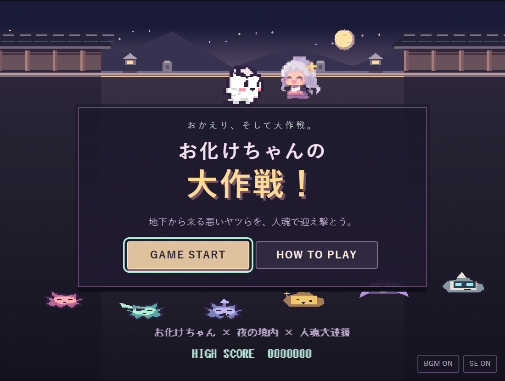
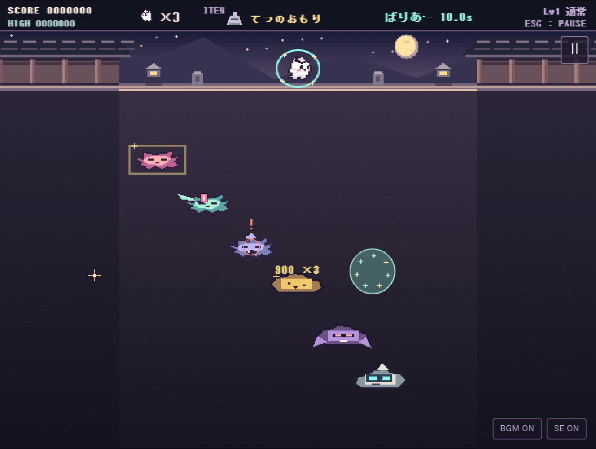

# お化けちゃんの大作戦！

黄泉から帰ってきたお化けちゃんが、人魂で地下の悪いヤツらを迎え撃つ、固定画面のエンドレス・スコアアタックです。

## 遊び方

このフォルダの **[index.html](index.html)** をブラウザで開き、タイトルの「GAME START」を選んでください。インストールは不要です。

| キー | 操作 |
|---|---|
| ← / → | 左右移動。両押しで停止 |
| Z / X | 左 / 右から人魂投下。長押しで連射 |
| Esc | ポーズ / 再開 |

画面右下でBGMと効果音を個別に切り替えられます。ゲーム画面から別のウィンドウへ移ると自動でポーズします。

## 基本ルール

- 人魂は敵や敵弾に触れると爆発し、周囲の敵や敵弾を巻き込みます。
- 通常の人魂は左右それぞれ3発まで。爆発が終わると次の1発を投下できます。
- 深い位置の敵ほど高得点。同じ攻撃で続けて倒すと、得点が×2、×3、最大×4になります。
- 残機は3体。敵弾に当たると1体減り、残機がなくなるとゲームオーバーです。
- 10,000 / 30,000 / 60,000 / 100,000点で、それぞれ残機が1体増えます。
- クリアのないエンドレス形式です。自己ベストに挑戦しましょう！

ハイスコアと音設定は、遊んでいるブラウザに保存されます。

## アイテム

光る敵を倒すとアイテムが浮上します。地上へ上がってきたところを拾いましょう。

| アイテム | 効果 |
|---|---|
| てつのおもり | 次の攻撃で、敵と敵弾を貫通する錘を投下 |
| はなび！ | 次の攻撃で、大爆発する人魂を投下 |
| だんまく！ | 次の攻撃で、最大7発の人魂を横一列に投下 |
| ばりあー | 10秒間無敵 |
| お化けちゃん | 残機が1体増える（最大9体） |

攻撃アイテムは1つだけ持てます。次の攻撃で自動的に使い、新しく拾うと上書きされます。

ばりあーは終了2秒前から、バリアと残り時間が点滅して効果の終了を知らせます。

## ライセンス

本作品のプログラムコード、ドキュメント、キャラクター、イラスト、ドット絵、ロゴ、効果音など、本リポジトリに収録する作品全体をMIT Licenseのもとで公開しています。
詳細は [LICENSE](LICENSE) をご覧ください。

ゲームのプレイ、実況動画の配信、スクリーンショットの投稿、作品の紹介は歓迎します。
改変、再配布、素材の利用についてもMIT Licenseの条件に従ってご利用いただけます。
