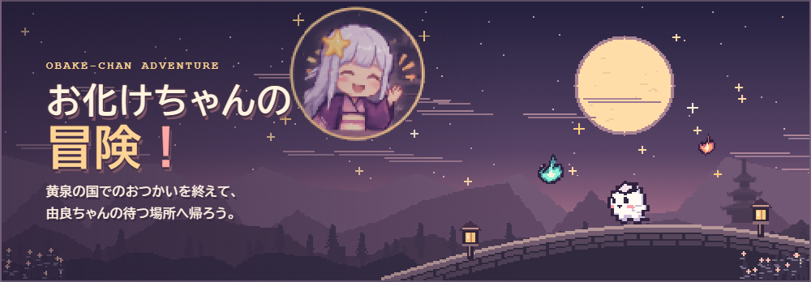
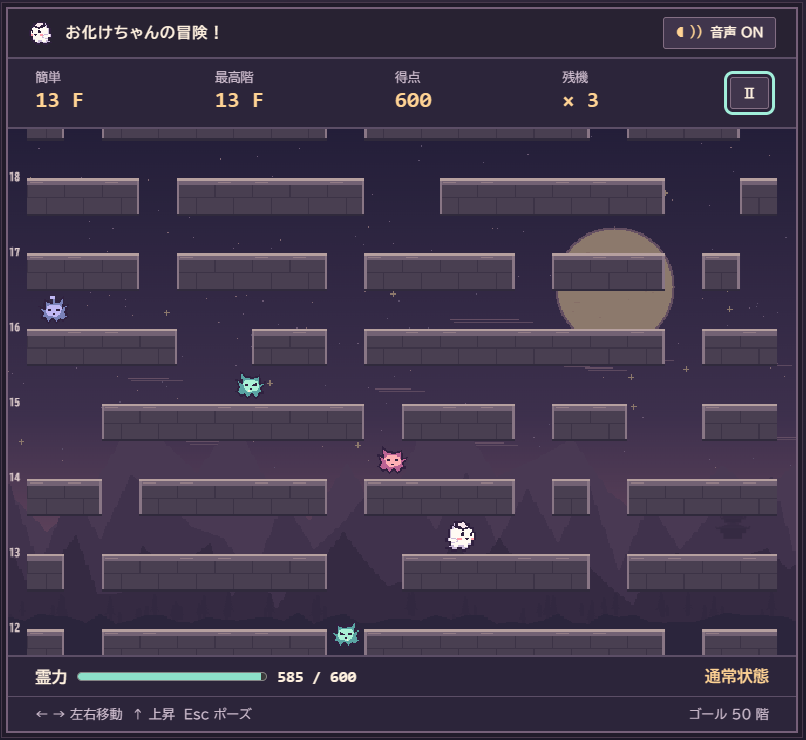
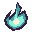
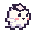
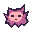
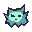
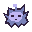

# お化けちゃんの冒険！

ちっちゃなお化けちゃんの、ちょっと大変なおつかい。

## ゲーム概要

『お化けちゃんの冒険！』は、レトロゲーム風のシンプルなアクションゲームです。

由良ちゃんに頼まれて、黄泉の国へおつかいに出かけたお化けちゃん。  
ところが、帰り道にはいじわるな悪い奴らがいっぱい！

悪い奴らをかわしながら、床の穴を通り抜け、由良ちゃんの待つ地上を目指しましょう。

## 遊び方

このフォルダの **index.html** をブラウザで開き、タイトルで「簡単」「普通」「困難」「無限回廊」から選んでね。  
ゲーム本体は HTML、CSS、JavaScript、Canvas 2D、Web Audio で動作する。インストール、ビルド、通信は不要だよ。

| 操作 | キー |
|---|---|
| 左右に移動 | ←・→、A・D、テンキー4・6 |
| 1マス上昇 | ↑、W、テンキー8 |
| ポーズ・再開 | Esc、または画面上部のポーズボタン |

キーを押し続けると連続移動します。  
左右同時は相殺し、上昇と横移動が同時なら通れる上昇を優先します。  
タッチ端末・小さい画面では画面下の移動ボタンも使えます。  
タイトルや終了画面のボタンは Tab と Enter でも選択できます。  
右上で効果音を切り替えられる。  
ウィンドウがフォーカスを失うと自動でポーズします。

## 基本ルール

- 左右に移動し、床の穴から1マスずつ上昇します。
- 穴を抜けて上の通路に出ると、1階進みます。
- 無敵状態以外で悪い奴らに触れると、1ミスになります。
- 霊力は時間とともに減り、尽きると1ミスになります。
- 残機は3体。ミス後は到達済みの最高階から再開し、残機がなくなるとゲームオーバーです。
- アイテムを上手に活用して進みましょう。

## アイテム

| アイテム | 得点 | 効果 |
|---|---:|---|
| ちからぱわー | 500 | 頭上の床を最大5回ぶち抜いて上昇できます。 |
| むてきぱわー | 1,000 | 10秒間無敵になり、触れた悪い奴らをやっつけられます。取得時に霊力が回復します。 |

むてきぱわーの効果中に悪い奴らをやっつけると、1体につき200点を獲得できます。
アイテムの効果は、最後に取ったものに切り替わります。

## キャラクター

### お化けちゃん

本作の主人公。ちっちゃくて可愛いお化け。  
由良ちゃんに頼まれて黄泉の国へおつかいに出かけます。

### 由良ちゃん

お化けちゃんの帰りを待っている銀髪の幽霊の女の子。  
お化けちゃん、気をつけて帰ってきてね！

### 悪い奴ら

黄泉の国に住んでいるいじわるな奴ら。  
お化けちゃんの帰り道を邪魔します。

## 難易度

黄泉の国から地上への帰還を目指します。  
無事に由良ちゃんのところまで帰ることができるかな？

| 難易度 | ゴール |
|---|---|
| 簡単 | 50階 |
| 普通 | 250階 |
| 困難 | 999階 |
| 無限回廊 | ゴールなし |

上の階ほど、悪い奴らが出やすくなり、動きも速くなります。  
無限回廊では、残機がなくなるまで上を目指して、最高到達階とハイスコアに挑戦しましょう。

## 特徴

- レトロなドット絵グラフィック
- シンプルな操作とゲームルール
- プレイするたびに変化するステージ
- アイテムを活用した敵の回避と撃退
- ついつい何度も遊んでしまうスコアアタック

## 開発について

本作は、1980年代のレトロゲーム、特に『ジーザス』に登場するミニゲーム「SPACE MONSTER」へのオマージュとして制作しています。

昔のゲームにあった、シンプルながらも何度も挑戦したくなる面白さを目指しました。

企画・仕様検討・グラフィック制作・プログラム開発には、ChatGPTおよびCodexを活用しています。

## コンセプト

**ついつい遊んでしまう、くだらないゲームを作りたい。**

そんな思いつきから生まれたゲームです。

## ライセンス

本作品のプログラムコード、ドキュメント、キャラクター、イラスト、ドット絵、ロゴ、効果音など、本リポジトリに収録する作品全体をMIT Licenseのもとで公開しています。
詳細は [LICENSE](LICENSE) をご覧ください。

ゲームのプレイ、実況動画の配信、スクリーンショットの投稿、作品の紹介は歓迎します。
改変、再配布、素材の利用についてもMIT Licenseの条件に従ってご利用いただけます。
